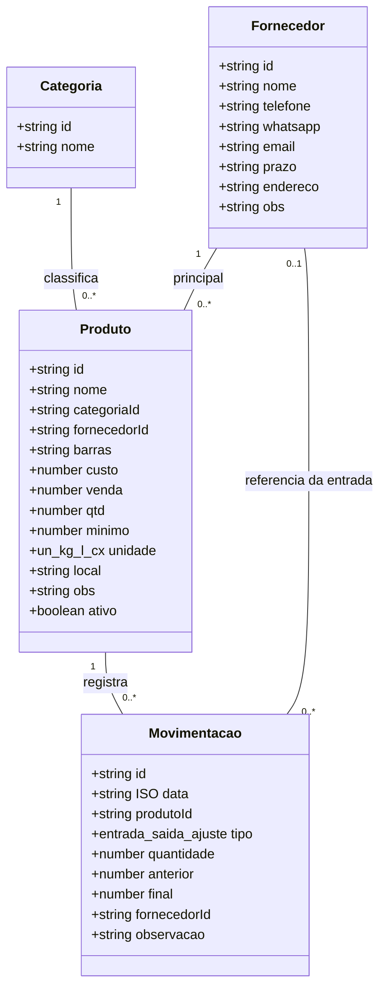

# Modelo de dados da entrega

Este é o diagrama vigente após os quatro pacotes de Dorsa. Representa objetos e referências realmente serializados pelo JavaScript. O software não declara classes ES6 nem herança: entrada, saída e ajuste são valores de `tipo` em Movimentacao. Não se deve apresentar subclasses como implementadas.

Dashboard e relatórios são telas de navegação/consulta; não são classes de domínio. Login demonstrativo é uma lista fixa em login.js, com senha comum; sessionStorage guarda apenas logado e usuario. Não há entidade persistida Usuario, permissões individuais ou vínculo de autoria nas movimentações.

Cada produto novo exige uma categoria e um fornecedor existentes. Produtos são inativados, nunca excluídos pela aplicação. Cada movimentação referencia um produto; fornecedorId é obrigatório nas novas entradas e vazio nas saídas e ajustes. A multiplicidade geral 0..1 inclui esses últimos tipos e registros legados sem fornecedor. O fornecedor histórico não muda quando o fornecedor principal do produto muda. A exclusão de fornecedor referenciado por qualquer produto ou movimentação é bloqueada.

Em ajustes novos, quantidade é a diferença final - anterior (pode ser negativa); o formulário solicita o saldo final. Nos ajustes legados, quantidade pode conter o saldo final: interpretar anterior/final nesses registros. Dados antigos são preservados, sem inventar fornecedores ausentes.

As listas ficam no objeto estado_mercadinho_v3 do localStorage. As chaves antigas ficam preservadas como cópia da migração e não devem ser editadas para alterar a versão nova. Não há banco externo.

## Fonte editável

